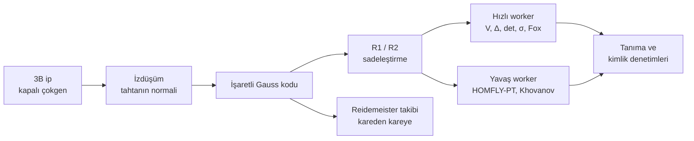

# KnotLab XR · Düğüm Laboratuvarı

Bir düğümü elinize alın, çekip uzatın, döndürün. Gölgesi tahtada Reidemeister hamleleriyle değişirken değişmezlerinin yerinde durduğunu izleyin.

KnotLab XR, düğüm teorisi için tarayıcıda çalışan etkileşimli bir laboratuvardır. Masaüstünde, VR gözlükte ve karma gerçeklikte (passthrough AR) çalışır. Kâğıda çizilmiş bir düğümün fotoğrafını ya da kamera görüntüsünü okuyup hangi düğüm olduğunu söyler ve onu elinizle tutabileceğiniz bir ipe çevirir. Düğümün Seifert yüzeyini kurup gösterir, Seifert matrisini yüzeyin kendisinden hesaplar; düğümün lifli olup olmadığını, bir düzlem eğrisi tekilliğinin bağı olup olmadığını ve tümleyeninin geometrisini anlatır. Düğüm, kendi içinden geçemeyen gerçek bir ip olarak modellenir. Her karede ipin bir düzleme izdüşümü işaretli bir Gauss koduna çevrilir. Jones, Alexander, Conway ve HOMFLY-PT polinomları, Khovanov homolojisi, determinant, imza ve Fox renklendirmeleri canlı olarak hesaplanır.

**Tek bir HTML dosyası.** Sunucu, kurulum ya da derleme gerekmez. Bütün hesaplar tarayıcıda, Web Worker'larda yapılır; hiçbir veri cihazdan çıkmaz. KnotInfo tablosu yalnızca bulunan düğüme ad vermek için kullanılır; polinomlar ve homoloji her zaman diyagramın kendisinden hesaplanır.

---

## Neler yapabilirsiniz

- **İzotopi.** İpi tutup çekin. Çekilen nokta, etki yarıçapı içinde yumuşak bir düşümle komşularını sürükler. *İzotopi kalkanı* açıkken ip kendi içinden ya da başka bir bileşenin içinden geçemez; yapılan her hareket gerçekten bir izotopidir. *Gevşet* düğümü itici bir enerjiyle yayar, *Gerginleştir* ipi kısaltır.
- **Düğüm çizme.** Ekrana kapalı bir eğri çizin. Kesişimler sırayla üst/alt atanarak eğri 3B'ye kaldırılır; sonuç çizdiğiniz gölgenin alternatif düğümüdür. VR'da havaya doğrudan 3B düğüm ya da tahtaya diyagram çizebilirsiniz. Shift ile (VR'da *Bileşen ekle* ile) mevcut düğüme yeni bileşen eklenir.
- **Reidemeister hamleleri.** Düğümün arkasındaki kara tahtada, tahtanın normali yönündeki gölgesi çizilir. Düğümü döndürdükçe ya da çektikçe gölgede oluşan R1, R2 ve R3 hamleleri yakalanır, işaretlenir ve sayılır. *R1 kıvrımı* aracı istenen işaretli bir kıvrımı elle ekler.
- **Kesişim değiştirme.** Diyagramda ya da ipte bir kesişime tıklayın; üst ve alt iplik yer değiştirir. Bu bilinçli olarak izotopi değildir: yoncada bir kesişimi değiştirmek onu çözülmüş düğüme çevirir.
- **Fox p-renklendirmeleri.** p = 3, 5, 7, 11, 13 için otomatik renklendirme ya da yaylara tek tek tıklayarak elle boyama. Her kesişimde 2·üst ≡ alt₁ + alt₂ (mod p) kuralı denetlenir; geçerli kesişimler yeşil, hatalı olanlar kırmızı halkayla gösterilir. Reidemeister hamlelerinden sonra renkler yeni yaylara kendiliğinden taşınır ve gerekirse Z/p üzerinde onarılır. Düğüm p-renklendirilemiyorsa (p ∤ det) bu söylenir ve uygun bir p önerilir.
- **Renk kipleri.** Bileşen, Fox, Seifert (Seifert çemberleri ve yönlü düzleştirmeler) ve eğrilik.
- **Fotoğraftan ya da kameradan okuma.** Kâğıda, tahtaya ya da ekrana çizilmiş bir düğüm diyagramının fotoğrafını yükleyin, sürükleyip bırakın ya da panodan yapıştırın (Ctrl/Cmd + V). Telefonda doğrudan fotoğraf çekebilir, bilgisayarda kamerayı canlı açabilirsiniz. Alt iplikteki boşluklardan üst/alt bilgisi çıkarılır, düğüm adı ve değişmezleri hemen gösterilir. Okunan kesişimler önizlemede işaretlenir; emin olunamayan kesişimler turuncu çizilir ve üzerine tıklanarak düzeltilir. *3B'ye aktar* ile diyagram, kesişimleri aynen koruyan bir ipe kaldırılır; artık çekip uzatılabilir, VR'da elle tutulabilir.
- **Örgü sözcükleri.** Tanınan her düğüm ve bağ için KnotInfo ve LinkInfo'daki örgü sözcüğü, örgü indeksiyle birlikte gösterilir ve küçük bir örgü diyagramı olarak çizilir. *Örgü kapanışı olarak yükle* düğmesi düğümü kendi örgüsünün kapanışı olarak yeniden kurar. Aynalarda bütün üreteçlerin işareti değişir; iki asalın bağlı toplamında ikinci sözcük kaydırılarak birleştirilir.
- **Seifert yüzeyi.** Tahtadaki diyagramdan Seifert algoritmasıyla iki renkli (pozitif yüz turuncu, negatif yüz mavi) gerçek bir 3B yüzey kurulur: her Seifert çemberi bir disk, iç içe çemberler üst üste katlar, her kesişim yarım bükümlü bir bant. Yüzey düğümle birlikte döner ve VR'da elle tutulabilir. *H₁ üreteçleri* yüzeyin birinci homolojisinin tabanını renkli eğriler olarak çizer. *Örgüden kanonik yüzey* düğümü örgü kapanışı olarak yükleyip diskleri iplik, bantları örgü harfi olan yüzeyi gösterir.
- **Seifert matrisi ve ondan gelenler.** Vij = lk(γi, γj+), yüzeydeki üreteç eğrileriyle pozitif yöne itilmiş kopyalarının bağlantı sayılarıdır ve yüzeyin geometrisinden sayılır. Matristen Δ(t) = det(V − tVᵀ), imza σ(V + Vᵀ), devirli dallanmış örtülerin homolojisi H₁(Σₙ) (n = 2…9) ve lifli düğümlerde homolojik monodromi hesaplanır; her biri bağımsız hesaplarla ve KnotInfo ile karşılaştırılır.
- **Lifli mi?** Kanıtıyla birlikte söylenir. Δ monik değilse lifli değildir (Neuwirth, Stallings). İndirgenmiş diyagram homojense (alternatif ve pozitif diyagramlar dahil) lifli olmak Δ'nın monik olmasına denktir (Murasugi, Gabai, Cromwell). Tanınan düğümün örgüsü homojense kapanışın yüzeyi liftir (Stallings). Geriye kalan birkaç düğümde KnotInfo'nun düğüm Floer homolojisine dayanan değeri gösterilir. Lifli düğümlerde KnotInfo'nun Dehn bükümü sözcüğü, homolojik monodromi h = V⁻¹Vᵀ, mertebesi ya da homolojik genişleme çarpanı ve Nielsen–Thurston tipi verilir.
- **Cebirsel mi?** Düğüm bir düzlem eğrisi tekilliğinin bağıysa f(x, y) polinomu, Milnor sayısı ve monodrominin mertebesi gösterilir; simit düğümlerinde Δ(t) = (tpq − 1)(t − 1)/((tp − 1)(tq − 1)) eşitliği denetlenir. *{f = 0} ∩ S³ olarak yükle* düğümü doğrudan karmaşık eğrinin üç-küreyle kesişiminden, stereografik izdüşümle kurar. Tekillik kataloğu (x² − y², x² − y³, …, x³ − y⁵, y(x² − y³)) uygulamanın kendi tanıma hattıyla adlandırılmıştır.
- **Tümleyen.** Geometrik tip (hiperbolik, simit, bileşik), hiperbolik hacim, ideal üçgenleme ve SnapPy sayım adı, kasp şekli (çizimiyle), Chern–Simons değişmezi, simetri grubu, tünel sayısı; simit düğümlerinde π₁ = ⟨x, y | xp = yq⟩. Bunlar KnotInfo'dan okunur; dallanmış örtülerin homolojisi ise Seifert matrisinden hesaplanır.
- **Katalog.** 10 kesişime kadar 249 düğüm ve 7 kesişime kadar 44 bağ; ada, kesişim sayısına ya da sözcüğe göre aranabilir, tek tıkla yüklenir, tablo olarak kopyalanır.
- **Karma gerçeklik.** *Masaya koy* ile kumandayı ya da elinizi gerçek bir masaya doğrultun; WebXR Hit Test ile bulunan yüzeye düğüm küçülüp düz yatar. Diyagram tahtası masanın üzerine yatırılır: tahtadaki çizim düğümün masaya düşen gerçek gölgesidir. Cihaz destekliyorsa düğüm WebXR Anchors ile odaya sabitlenir.

## Hesaplananlar

Polinomlar ve homoloji, R1 ve R2 hamleleriyle sadeleştirilmiş diyagramdan; Seifert yüzeyi ve matrisi diyagramın kendisinden (tanınan düğümlerde örgü kapanışından) hesaplanır.

| Değişmez | Yöntem |
| --- | --- |
| Jones V(t) | Kauffman köşeli parantezi; durum toplamı, sınır eşleşmeleri üzerinde düzlemsel dinamik programlama, BigInt katsayılar. V = (−A³)^(−w)⟨D⟩, t = A⁻⁴ |
| Alexander Δ(t) | Alexander matrisinin bir minörü. Her kesişim için bir satır, her yay için bir sütun; t'nin m+1 noktasında üç büyük asal modülünde determinant, Newton interpolasyonu ve Çin kalan teoremi. Conway normalizasyonu: Δ(1) = 1, Δ(t) = Δ(t⁻¹) |
| Conway ∇(z) | Δ'dan t + t⁻¹ = z² + 2 dönüşümüyle; HOMFLY-PT'den P(1, z) ile çapraz kontrol |
| HOMFLY-PT P(v, z) | v⁻¹P(L₊) − vP(L₋) = zP(L₀). Azalan (descending) diyagrama doğru skein özyinelemesi, diyagram anahtarıyla bellekleme, her adımda R1/R2 sadeleştirmesi. KnotInfo ile aynı değişken kuralı |
| Khovanov Kh^(i,j) | Çözünürlükler küpü (2ⁿ köşe) ve V = ⟨v₊, v₋⟩ Frobenius cebiriyle Khovanov diferansiyeli. Zincir kompleksi F_p (p = 1 000 003) üzerinde seyrek Gauss eliminasyonuyla iptal edilerek küçültülür. İndirgenmemiş; p-burulma yoksa rasyonel ranklarla çakışır |
| Determinant | Renklendirme matrisinin indirgenmiş minörü, Bareiss algoritmasıyla tam sayı aritmetiği |
| Fox p-renklendirmeleri | Renklendirme matrisinin Z/p üzerindeki çekirdeği; renklendirme sayısı p^(sıfırlık) |
| İmza σ | Gordon–Litherland: Goeritz matrisinin imzası eksi düzeltme terimi μ. İki dama tahtası boyamasıyla da hesaplanır; özdeğerler Jacobi yöntemiyle, sıfırlık kesin rankla (mod p) |
| Arf | Δ(−1) mod 8 (Levine); V(i) ile çapraz kontrol (Murakami) |
| Seifert cinsi | span Δ / 2 ≤ g ≤ (c − s + 1) / 2 (Seifert algoritması); iki sınır eşitse g kesin olarak verilir |
| Çözme sayısı | u ≥ \|σ\| / 2 (Murasugi) |
| Örgü indeksi | MFW alt sınırı ≤ b ≤ Seifert çemberi sayısı (Morton, Franks–Williams; Yamada) |
| Bağlar | Bileşen sayısı, bağlantı sayısı matrisi |
| Kodlar | İşaretli Gauss kodu, PD kodu (KnotTheory\` kuralı), Wirtinger sunumu |
| Seifert yüzeyi | Seifert algoritması; iç içelik derinliğine göre katlanmış diskler ve yarım bükümlü bantlar, kulak kırpma üçgenlemesi |
| Seifert matrisi | Seifert çizgesinin bir yayılan ağacı dışındaki her bant bir H₁ üreteci verir. Eğriler bantlarda ayrı şeritlerden, disklerde üçgenlemenin içinden geçer; bağlantı sayıları genel konumlu bir izdüşümde işaretli kesişimler sayılarak tam sayı olarak bulunur, itme mesafesi matris değişmeyene kadar küçültülür |
| H₁(Σₙ) | Γ = (Vᵀ − V)⁻¹Vᵀ için Γⁿ − (Γ − I)ⁿ matrisinin Smith normal biçimi, BigInt |
| Homolojik monodromi | det V = ±1 olduğunda h = V⁻¹Vᵀ; mertebe ya da Δ'nın en büyük kökünün modülü |
| Lifli olma | Δ'nın baş katsayısı; Seifert çizgesinin bloklarında işaret homojenliği (Tarjan) |
| 3B eğri | Writhe ve Gauss bağlantı integrali (Klenin–Langowski), ortalama kesişim sayısı, toplam eğrilik (Fáry–Milnor), ip uzunluğu L/r |

**Tablodan gelenler.** Düğüm tanındığında gösterilen kesişim sayısı, çözme sayısı, 3-cins, 4-cins, örgü ve köprü indeksi, hiperbolik hacim, Rasmussen s, Ozsváth–Szabó τ, simetri tipi, tümleyenin kasp şekli, ideal üçgenlemesi, Chern–Simons değişmezi, simetri grubu ve tünel sayısı ile monodrominin Dehn bükümü sözcüğü uygulamada **hesaplanmaz**; KnotInfo'dan okunur. Seifert matrisi, dallanmış örtülerin homolojisi ve lifli olmanın kanıtı ise hesaplanır.

### Her hesapta yeniden denetlenen kimlikler

Her yeni diyagram için aşağıdaki teoremler sayısal olarak denetlenir ve panelde ✓/✗ olarak gösterilir. Böylece hesapların kendi kendini doğrulaması ekranda görünür.

| Kimlik | Kaynak |
| --- | --- |
| det = \|Δ(−1)\| = \|V(−1)\| = \|det G\| | Alexander; Jones; Goeritz |
| V(1) = (−2)^(μ−1) | Jones |
| V(e^(2πi/3)) = (−1)^(μ−1) | Jones |
| 3-renklendirme sayısı = 3·\|V(e^(iπ/3))\|² | Lickorish–Millett; Przytycki |
| V(i) = (−1)^Arf | Murakami |
| Δ(−1) > 0 ⇔ σ ≡ 0 (mod 4) | Murasugi |
| \|σ\| ≤ 2g | Murasugi |
| P(t, t^½ − t^−½) = V(t) ve P(1, z) = ∇(z) | HOMFLY-PT |
| MFW sınırı ≤ Seifert çemberi sayısı | Morton; Franks–Williams |
| χ(Kh) = (q + q⁻¹)·V(q²) | Khovanov |
| V(ham diyagram) = V(sadeleştirilmiş diyagram) | Reidemeister |

### Tanıma

- **Asal düğümler:** 10 kesişime kadar KnotInfo (249 düğüm). Aynalar dahil Jones polinomuyla arama, ardından Alexander, imza ve gerekirse Khovanov ile eleme. Sağ elli ve sol elli yonca, ya da kiral bir düğüm ile aynası ayrı gösterilir.
- **Bileşik düğümler:** Jones polinomu bağlı toplamda çarpımsaldır. Bu yüzden 8 kesişime kadar iki asal düğümün (aynalar dahil) toplamları aranır ve imzayla elenir. Kare düğüm ile büyükanne düğümü böyle ayrılır.
- **Bağlar:** 7 kesişime kadar LinkInfo (44 yönlü kayıt).
- **Çözülmüş düğüm:** Khovanov homolojisi çözülmüş düğümünkiyle aynıysa sonuç bir kanıttır (Kronheimer–Mrowka).
- **Ayırt edilemeyen çiftler:** Hesaplanan değişmezlerin hepsi aynıysa tüm adaylar listelenir. Örneğin 10₁₂₉ ile 8₈'in aynası aynı Jones, Alexander, HOMFLY-PT, imza ve Khovanov değerlerine sahiptir. 10₁₃₂ ile 5₁'in aynası aynı Jones, Alexander ve HOMFLY-PT'ye sahiptir; imza (0 ve 4) ile Khovanov homolojisi onları ayırır.

## Doğrulama

Matematik çekirdeği arayüzden ayrı bir modül olarak Node.js'te KnotInfo ve LinkInfo verisine karşı test edildi (veri: Kasım 2026).

| Test | Sonuç |
| --- | --- |
| Jones, KnotInfo örgü kelimelerinden | 249 / 249 birebir |
| HOMFLY-PT, örgü kelimelerinden | 249 / 249 birebir |
| Khovanov homolojisi, PD kodlarından | 249 / 249 birebir; en uzun hesap 131 ms |
| İmza, iki dama tahtası boyamasıyla | 249 / 249 |
| Determinant | 249 / 249 |
| Alexander | 249 / 249, ±1 birim farkına kadar. KnotInfo baş katsayıyı pozitif alır, KnotLab XR Δ(1) = 1 alır; iki kural 139 düğümde çakışır |
| Jones, LinkInfo bağları (≤ 7 kesişim) | 44 / 44 birebir |
| İzotopi kalkanı | Bir halka başka bir halkanın ipliğinden zorla geçirildi. Kalkan ve çarpışmalar kapalıyken bağlantı sayısı 0'dan −1'e değişti; kalkan açıkken 0'da kaldı |
| Kesişim değişimi | 3₁ → 0₁, 4₁ → 0₁, 5₁ → 3₁ |
| Seifert matrisi, örgü kapanışlarından | 249 / 249 düğümde det(V − tVᵀ) Alexander polinomuna, σ(V + Vᵀ) imzaya, H₁(Σₙ) (n = 2…9) KnotInfo'nun burulma sayılarına eşit |
| Seifert matrisi, rastgele izdüşümlerden | Örgü kapanışları rastgele yönlerden izdüşürüldü (iç içe ve yan yana çemberli karışık diyagramlar, en çok 45 kesişim): 684 / 684 |
| Seifert matrisi, bağlar | 88 / 88 (LinkInfo örgüleri, iki yönden): Alexander ±tᵏ belirsizliğiyle ve imza eşit |
| Lifli olma | 249 düğümün 206'sında kanıt (monik olmama ya da homojen diyagram) diyagramdan çıktı; hepsi KnotInfo ile aynı. Kalan 43 düğümde örgü homojenliği ya da KnotInfo kullanılır |
| Tekillik bağları | {f = 0} ∩ S³ eğrileri uygulamanın tanıma hattına verildi: x² − y³ → 3₁ (pozitif), x³ − y⁴ → 8₁₉, x³ − y⁵ → 10₁₂₄, x² − y⁴ → L4a1, y(x² − y³) → L7n1; yazılım ve bağlantı sayıları pozitif |
| Görüntüden okuma, sentetik çizimler | Tablodaki 249 düğümün ve 44 bağın örgü kapanışları, birbirinden farklı sekiz çizim stilinde resme döküldü ve geri okundu (aşağıdaki tablo) |
| Canlı kamera | Chrome'un sahte kamera aygıtına verilen 6₂ çiziminden masaüstünde ve emüle AR oturumunda 6₂ okundu ve ipe aktarıldı |
| Arayüz ve WebXR | Masaüstü, mobil ve WebXR yolları başsız Chrome'da Playwright ile; VR ve AR oturumları, kumandalar, el takibiyle çimdikleyerek çizim, menü ve masaya yerleştirme Meta'nın IWER emülatöründe (Quest 3 profili) |

Gerçek bir VR gözlükte test edilmedi.

**Görüntüden okuma testleri.** Her düğüm, KnotInfo/LinkInfo örgü sözcüğünün kapanışı olarak çizildi, alt geçitlerde boşluk bırakılarak resme döküldü ve okundu. *Doğru*: tanınan ad referansla aynı. *Belirsiz*: okunan diyagram doğru, ama hesaplanan değişmezler iki düğümü ayırmadığı için birden çok aday gösterildi (ör. 10₁₂₉ ve 8₈'in aynası). *Yanlış*: başka bir düğüm adı verildi. *Okunamadı*: uyarıyla birlikte sonuç verilmedi.

| Stil | Doğru | Belirsiz | Yanlış | Okunamadı |
| --- | --- | --- | --- | --- |
| Temiz çizim | 285 | 8 | 0 | 0 |
| Fotoğraf: gürültü, ışık eğimi, bulanıklık, döndürme, perspektif, el titremesi | 278 | 6 | 0 | 9 |
| Kara tahta (açık mürekkep, koyu zemin) | 285 | 8 | 0 | 0 |
| İnce kalem | 285 | 8 | 0 | 0 |
| Kalın keçeli, kısa boşluklar | 284 | 8 | 0 | 1 |
| Açık kurşun kalem | 285 | 8 | 0 | 0 |
| Küçük resim (420 × 340) | 285 | 8 | 0 | 0 |
| Fotoğraf ve iplikler boşlukta birbirine değiyor | 276 | 8 | 2 | 7 |

Toplam 293 diyagram (249 düğüm, 44 bağ). Node.js'te bir okuma en çok yarım saniye sürdü.

Bu testler sentetiktir; gerçek fotoğraflar daha zor olabilir. Okuyucu emin olamadığında çoğunlukla yanlış ad vermek yerine durur ve nedenini söyler. En zor stildeki iki yanlış okumada (7₂ bir bağ olarak, 10₆₀ tabloda olmayan bir düğüm olarak okundu) iplikler alt geçidin boşluğunda birbirine değiyordu.

## Çalıştırma

**Bilgisayarda.** `index.html` dosyasını Chrome, Edge, Firefox ya da Safari'de açın. three.js ve yazı tipleri CDN'den yüklendiği için internet bağlantısı gerekir.

**VR ve karma gerçeklik.** WebXR yalnızca güvenli bağlamda (https) çalışır. En kolay yol GitHub Pages:

1. Bu depoyu GitHub'a yükleyin (`index.html` kök dizinde olmalı).
2. *Settings → Pages → Build and deployment* altında *Deploy from a branch*, dal `main`, klasör `/ (root)` seçin.
3. Birkaç dakika sonra `https://<kullanıcı-adı>.github.io/<depo-adı>/` adresini Quest Browser'da açın.
4. *VR'da aç* ya da *AR'da aç* düğmesine basın.

Fotoğraf yükleme her yerde çalışır. Canlı kamera da güvenli bağlam (https) ister; bazı uygulama içi önizlemeler kamerayı engeller, o zaman fotoğraf yükleyin.

Masanın tanınması için Quest'te *Alan Kurulumu* (Space Setup) yapılmış olmalıdır; yapılmamışsa düğüm zemine konur. Quest 2'de passthrough siyah-beyazdır.

## Kontroller

### Masaüstü

| Eylem | Kontrol |
| --- | --- |
| Araç seç: İzotopi, Çiz, R1 kıvrımı, Kesişim değiştir, Boya | `1` `2` `3` `4` `5` |
| İpi çek | İpe tıklayıp sürükle |
| Çekerken derinlik / etki yarıçapı | Tekerlek / Shift + tekerlek |
| Kamerayı döndür, yakınlaştır | Boşlukta sürükle, tekerlek |
| Düğümü döndür | Ctrl, Alt ya da sağ tuşla sürükle |
| Gevşet, Gerginleştir, Döndür | `R` `T` `S` |
| Tahtayı bakış yönüne hizala | `A` |
| Otomatik renklendir | `C` |
| R1 kıvrımının işaretini değiştir | `K` |
| Geri al | `Z` ya da Ctrl/Cmd + `Z` |
| Kesişim değiştir | Sağ alttaki diyagramda kesişime tıkla |
| Tablodan düğüm yükle | Üstteki kutuya ad yaz: `8_17`, `10_132`, ya da *Katalog* |
| Çizimden oku | *Fotoğraftan oku*: dosya seç, sürükle-bırak, yapıştır ya da *Kamerayı aç* |
| Okunan kesişimi düzelt | Önizlemede kesişime tıkla |
| Örgü kapanışını yükle | Sağ paneldeki örgü kutusunda *Örgü kapanışı olarak yükle* |
| Seifert yüzeyi | *Yüzey, lif ve tümleyen* bölümünde *Seifert yüzeyini göster*, *H₁ üreteçleri*, *Örgüden kanonik yüzey*; ipi tutunca yüzey kapanır |
| Tekillik bağı | *Cebirsel düğüm mü?* altında *{f = 0} ∩ S³ olarak yükle* |

### VR ve karma gerçeklik

| Eylem | Kontrol |
| --- | --- |
| İpi çek | İpe yakın tetik ya da çimdik; uzaktaki ipi ışınla da tutabilirsiniz |
| Düğümü taşı ve döndür | Boşlukta tetik ya da yan tuş (grip) |
| Ölçekle | İki elle tut, ellerinizi açıp kapatın |
| Etki yarıçapı | Başparmak çubuğu |
| Havada çiz | Çiz aracında tetiği basılı tutarak çizin |
| Tahtaya çiz | Çiz aracında tahtaya doğrultup çizin |
| Masaya koy | Menüde *Masaya koy*, sarı halka görününce tetik ya da çimdik |
| Kâğıttaki çizimi oku | Menüde *Kamerayla oku*; çizime bakın, okunan düğüm küçük panelde canlı görünür. *Görüleni al* ile ipe dönüşür |
| Seifert yüzeyi | Menünün son satırı: *Seifert yüzeyi*, *H₁ üreteçleri*, *Örgüden yüzey*, *Tekillik bağı*; *Bilgi: lif* sağdaki paneli yüzey, lif ve tümleyen sayfasına çevirir |
| Tablodaki düğümleri gez | *◀ Tablo* / *Tablo ▶*; *Örgü kapanışı* o düğümü örgüsünden kurar |

Sol yandaki menü panelinden tüm araçlara, fizik ayarlarına, renk kiplerine, hazır düğümlere, *Gölge: masa*, *Küçült* / *Büyüt* ve *Konumu sıfırla* düğmelerine ulaşılır. Sağdaki panel, tanınan düğümü, polinomları, Khovanov tablosunu ve kimlik denetimlerini gösterir.

## Hazır düğümler

- **Temel:** 0₁, 3₁ (sağ elli), 4₁, 5₁ = T(2,5), 5₂, 6₁ (stevedore), 6₂, 6₃ (amfikiral), 7₄, 8₁₉ = T(3,4), 10₁₂₄ = T(3,5)
- **Bağlar:** Hopf, Solomon T(2,4), Whitehead, Borromean halkaları, T(3,3)
- **Bileşik:** büyükanne düğümü 3₁ # 3₁, kare düğüm 3₁ # m(3₁)
- **Örnek çizimler:** *Fotoğraftan oku* penceresinde kurşun kalem, tükenmez, tebeşir ve gölge diyagramı örnekleri (4₁, 7₄, Whitehead bağı, 10₁₃₂, yonca gölgesi) ile o anki düğümün çizimi.
- **Meydan okumalar:** 10₁₃₂ (Jones ve HOMFLY-PT'si 5₁'in aynasıyla aynı), 8₈ ve 10₁₂₉ (Khovanov da ayırmaz), 11 kesişimli bir diyagrama gizlenmiş çözülmüş düğüm, Perko düğümü 10₁₆₁, 8₁₇ (tersinmez)
- 10 kesişime kadar tablodaki her düğüm adıyla yüklenebilir.

## Nasıl çalışır

- **İp fiziği.** Konum tabanlı dinamik: yumuşak seçimle sürükleme, iki-Laplasyen düzgünleştirme, segmentler arası çarpışma çözümü (çap 2r), adım kırpma ve uyarlamalı yeniden örnekleme.
- **İzotopi kalkanı.** Her alt adımda birbirine yakın segment çiftleri için dörtyüzlü hacminin işaretindeki değişim ve en yakın uzaklık denetlenir. İki iplik birbirinin içinden geçecek olursa o alt adım geri alınır.
- **Reidemeister takibi.** Ardışık karelerdeki kesişimler yay uzunluğu parametreleriyle eşleştirilir. Doğan ya da ölen ve birbirine yakın, zıt işaretli kesişim çifti R2; aynı bileşende kısa bir halka kapatan kesişim R1; üç farklı iplik parçasının oluşturduğu küçük üçgenin yönünün dönmesi R3 olarak sayılır. Bu sınıflandırma sezgiseldir (heuristic). Sayımdaki bir hata değişmezleri etkilemez, çünkü değişmezler her zaman diyagramın tamamından yeniden hesaplanır.
- **Görüntüden düğüme.** Görüntü gri tona çevrilir; Otsu yöntemiyle mürekkebin koyu mu açık mı olduğu (kâğıt ya da kara tahta) belirlenir, ardından Sauvola uyarlamalı eşiklemesiyle ikili maske çıkarılır. Çerçeveye değen büyük lekeler atılır, delikler doldurulur. Zhang–Suen inceltmesiyle bir piksel kalınlığında iskelet elde edilir ve bir çizgeye çevrilir: uçlar, kavşak kümeleri, kısa çıkıntıların budanması. Kavşaklarda hangi iki kolun aynı iplik olduğu, kolların ikinci dereceden bir eğriye uyumunun hatasıyla seçilir. Alt ipliğin boşluğunda kalan uçlar, uzaklık ve doğrultu uyumuna göre eşleştirilir; boşluklar Hermite eğrileriyle köprülenip kapalı bileşenler kurulur. Her kesişimde boşluğun hangi iplikte olduğu üst/alt bilgisini verir. İşaretli Gauss kodu buradan hesaplanır ve geri kalan her şey, elle çizilmiş bir düğümde olduğu gibi işler. Okuma üç farklı eşikleme ayarıyla denenir; boşluksuz kalan bir alt geçit (yanlış eşleşmenin belirtisi) ya da tahmin edilmiş kesişim içeren sonuçlar geride tutulur. İp, kesişimlerin üst/alt sırası korunarak 3B'ye kaldırılır.
- **Seifert yüzeyi ve matrisi.** Her kesişimin çevresinde, komşu kesişimlere ve başka ipliklere olan uzaklığa göre küçültülen bir pencere açılır; pencerenin dışında kalan yaylar yönlü düzleştirmeyle Seifert çemberlerine bağlanır. Her çember, kaç çemberin içinde olduğuna göre bir yüksekliğe konan düz bir disk olur; kesişimler, üst iplik yukarıda kalacak biçimde yarım bükümlü bantlara dönüşür. Böylece yüzeyin sınırı tam olarak diyagramın düğümüdür. Üreteç eğrileri bantları farklı şeritlerden geçer, disklerin içinde üçgenlemenin komşuluk çizgesi boyunca ilerler. Pozitif itme, disk ve bantların birleştiği dikişlerde iki yüzün açıortayı boyunca yapılır. Matris, itme mesafesi on kat küçültüldüğünde değişmeyene kadar yeniden hesaplanır. Panel, tanınan düğümler için örgü kapanışının yüzeyini kullanır; görünen yüzey ise tahtadaki diyagramınkidir.
- **Renklerin taşınması.** Fox renkleri ipin noktalarına iliştirilir. Her yeni diyagramda yayların rengi çoğunluk oyuyla belirlenir; çelişki çıkarsa en uzun yaylar önce sabitlenerek Z/p üzerinde çözülür.

### Dosyanın içi

`index.html` altı bölümden oluşur:

| Bölüm | İçerik |
| --- | --- |
| `<script id="tables-json">` | KnotInfo ve LinkInfo'dan çıkarılan özet tablolar |
| `<script id="km-src">` | Matematik çekirdeği ve analiz: saf JavaScript, DOM kullanmaz, Web Worker'da çalışır |
| `<script id="geo-src">` | Geometri, izdüşüm, Reidemeister takibi, ip fiziği; Seifert yüzeyi ve matrisi, tekillik bağları |
| `<script id="vis-src">` | Görüntüden diyagram okuma: eşikleme, inceltme, iskelet çizgesi, kesişim çözümü |
| `<script id="worker-src">` | Worker mesajları; üç worker: hızlı değişmezler, HOMFLY-PT ve Khovanov, 3B integraller |
| `<script type="module">` | three.js sahnesi, arayüz, WebXR |

## Sınırlamalar

- Khovanov homolojisi, sadeleştirilmiş diyagram en çok 13 kesişimliyse; HOMFLY-PT en çok 22 kesişimliyse hesaplanır. Daha büyük diyagramlarda önce *Gevşet* ya da *Gerginleştir* kesişim sayısını düşürebilir.
- Sadeleştirme yalnızca R1 ve R2 kullanır; sadeleştirilmiş diyagram en az kesişimli diyagram olmayabilir.
- Tanıma 10 kesişime kadar asal düğümlerle, iki asal düğümün toplamlarıyla ve 7 kesişime kadar bağlarla sınırlıdır. Bazı düğüm çiftleri hesaplanan hiçbir değişmezle ayrılamaz (ör. 10₁₂₉ ve 8₈'in aynası); bu durumda tüm adaylar gösterilir.
- Bağlar için Alexander polinomu ±t^k belirsizliğiyle verilir.
- Ayna ve yönelim kuralları KnotInfo'yu izler.
- İp uzunluğu L/r kaba bir yaklaşımdır; gerginleştirilmiş yonca yaklaşık 33,5'e iner (ideal yonca için bilinen değer yaklaşık 32,74).
- **Görüntüden okuma** çizimin standart düğüm diyagramı kuralına uymasını bekler: alttan geçen iplikte görünür bir boşluk olmalı. Boşluksuz çizimlerde (gölge diyagramı) kesişimler sırayla üst/alt atanır ve turuncu işaretlenir; tıklayarak düzeltmeniz gerekir. İki iplik kesişim dışında birbirine değiyorsa, ya da boşluklar çok kısaysa okuma başarısız olabilir ya da bir kesişim tahmin edilir. Gölgeli 3B çizimler, renkli dolgular ve tüp görünümlü düğümler için tasarlanmamıştır. Bağlarda bileşenlerin yönü fotoğraftan bilinemez; LinkInfo adındaki yönelim bu yüzden keyfidir.
- **Seifert yüzeyi** diyagramın kanonik yüzeyidir; diyagram alternatif ya da homojen değilse en küçük cinsli olmayabilir. Bu durumda monodromi KnotInfo'nun en küçük cinsli Seifert matrisinden hesaplanır ve panelde bu söylenir. Monodromi yalnızca homolojide hesaplanır; Dehn bükümü sözcüğü KnotInfo'dandır.
- **Tümleyen** verileri (hacim, kasp, üçgenleme, simetri grubu) KnotInfo'dan okunur, hesaplanmaz. Hesaplanan tek tümleyen değişmezi dallanmış örtülerin homolojisidir.
- **Cebirsel düğümler** küçük bir tekillik kataloğuyla karşılaştırılır; 10 kesişime kadar asal düğümlerde bu katalog eksiksizdir (yalnızca pozitif simit düğümleri), bağlarda değildir.
- **Kamera.** Masaüstü ve telefonda `getUserMedia` ile çalışır. Quest Browser'ın WebXR `camera-access` özelliğini desteklemediği bildiriliyor; *Kamerayla oku* bunun yerine gözlüğün kameralarını sıradan kamera olarak (getUserMedia, *Gözlük kameraları* izniyle) açmayı dener. Bu yol gerçek bir Quest'te test edilmedi. Açılamazsa fotoğraf yükleyin.
- Masa tanıma ve odaya sabitleme, Quest Browser'ın WebXR Hit Test ve Anchors desteğine bağlıdır. Bazı uygulama içi görüntüleyiciler (ör. sohbet uygulamalarının önizlemeleri) XR iznini engeller; o zaman sayfayı doğrudan https adresinden açın.

## Teşekkür ve kaynaklar

### Doğrudan kullanılanlar

- **KnotInfo ve LinkInfo.** Tanıma tabloları ve testlerdeki referans değerler. C. Livingston ve A. H. Moore, *KnotInfo: Table of Knot Invariants*, [knotinfo.org](https://knotinfo.org), Kasım 2026. C. Livingston ve A. H. Moore, *LinkInfo: Table of Link Invariants*, [knotinfo.org](https://knotinfo.org), Kasım 2026.
- **database_knotinfo** (Sebastian Oehms, GPL, sürüm 2026.11.2). KnotInfo verisini çevrimdışı çıkarmak için kullanıldı; sayfanın içinde yer almaz.
- **three.js** r170 (MIT), OrbitControls ve RoomEnvironment eklentileriyle.
- **WebXR Device API** ve modülleri: Hand Input, Hit Test, Anchors (W3C Immersive Web).
- **Yazı tipleri:** IBM Plex Sans, IBM Plex Mono ve STIX Two Text (SIL Open Font License), Google Fonts üzerinden.
- **Test araçları:** Node.js, Playwright, başsız Google Chrome (SwiftShader), IWER 2.8.0 (Meta, Immersive Web Emulation Runtime), veri ayrıştırmada SymPy.
- Kod, Anthropic'in Claude modeliyle birlikte yazıldı.

### Uygulanan matematik

**Diyagramlar ve hamleler**
- K. Reidemeister, Elementare Begründung der Knotentheorie, *Abh. Math. Sem. Univ. Hamburg* 5 (1927), 24–32.
- J. W. Alexander, G. B. Briggs, On types of knotted curves, *Ann. of Math.* 28 (1926–27), 562–586.
- D. Rolfsen, *Knots and Links*, Publish or Perish, 1976 (düğüm adları).
- K. A. Perko, On the classification of knots, *Proc. Amer. Math. Soc.* 45 (1974), 262–266.

**Polinomlar**
- J. W. Alexander, Topological invariants of knots and links, *Trans. Amer. Math. Soc.* 30 (1928), 275–306.
- J. H. Conway, An enumeration of knots and links, and some of their algebraic properties, *Computational Problems in Abstract Algebra*, Pergamon, 1970, 329–358.
- V. F. R. Jones, A polynomial invariant for knots via von Neumann algebras, *Bull. Amer. Math. Soc.* 12 (1985), 103–111.
- V. F. R. Jones, Hecke algebra representations of braid groups and link polynomials, *Ann. of Math.* 126 (1987), 335–388.
- L. H. Kauffman, State models and the Jones polynomial, *Topology* 26 (1987), 395–407.
- P. Freyd, D. Yetter, J. Hoste, W. B. R. Lickorish, K. Millett, A. Ocneanu, A new polynomial invariant of knots and links, *Bull. Amer. Math. Soc.* 12 (1985), 239–246.
- J. H. Przytycki, P. Traczyk, Invariants of links of Conway type, *Kobe J. Math.* 4 (1987), 115–139.
- W. B. R. Lickorish, K. C. Millett, A polynomial invariant of oriented links, *Topology* 26 (1987), 107–141 (azalan diyagramlarla özyineleme).
- W. B. R. Lickorish, K. C. Millett, Some evaluations of link polynomials, *Comment. Math. Helv.* 61 (1986), 349–359.
- H. Murakami, A recursive calculation of the Arf invariant of a link, *J. Math. Soc. Japan* 38 (1986), 335–338.

**Khovanov homolojisi**
- M. Khovanov, A categorification of the Jones polynomial, *Duke Math. J.* 101 (2000), 359–426.
- D. Bar-Natan, On Khovanov's categorification of the Jones polynomial, *Algebr. Geom. Topol.* 2 (2002), 337–370.
- D. Bar-Natan, Fast Khovanov homology computations, *J. Knot Theory Ramifications* 16 (2007), 243–255 (iptal yöntemi).
- P. B. Kronheimer, T. S. Mrowka, Khovanov homology is an unknot-detector, *Publ. Math. IHÉS* 113 (2011), 97–208.

**İmza, cins ve klasik değişmezler**
- H. Seifert, Über das Geschlecht von Knoten, *Math. Ann.* 110 (1935), 571–592.
- L. Goeritz, Knoten und quadratische Formen, *Math. Z.* 36 (1933), 647–654.
- C. McA. Gordon, R. A. Litherland, On the signature of a link, *Invent. Math.* 47 (1978), 53–69.
- K. Murasugi, On a certain numerical invariant of link types, *Trans. Amer. Math. Soc.* 117 (1965), 387–422.
- J. Levine, Polynomial invariants of knots of codimension two, *Ann. of Math.* 84 (1966), 537–554.

**Renklendirmeler**
- R. H. Fox, A quick trip through knot theory, *Topology of 3-Manifolds and Related Topics*, Prentice-Hall, 1962, 120–167.
- J. H. Przytycki, 3-coloring and other elementary invariants of knots, *Banach Center Publ.* 42 (1998), 275–295.

**Seifert yüzeyleri, lifler, örtüler**
- H. F. Trotter, Homology of group systems with applications to knot theory, *Ann. of Math.* 76 (1962), 464–498 (Seifert matrisinden imza).
- R. H. Fox, Free differential calculus III: Subgroups, *Ann. of Math.* 64 (1956), 407–419 (devirli dallanmış örtülerin homolojisinin mertebesi).
- L. Neuwirth, The algebraic determination of the genus of knots, *Amer. J. Math.* 82 (1960), 791–798.
- J. Stallings, On fibering certain 3-manifolds, *Topology of 3-Manifolds and Related Topics*, Prentice-Hall, 1962, 95–100.
- K. Murasugi, On a certain subgroup of the group of an alternating link, *Amer. J. Math.* 85 (1963), 544–550.
- J. R. Stallings, Constructions of fibred knots and links, *Proc. Sympos. Pure Math.* 32 (1978), 55–60.
- D. Gabai, The Murasugi sum is a natural geometric operation, *Contemp. Math.* 20 (1983), 131–143.
- D. Gabai, Detecting fibred links in S³, *Comment. Math. Helv.* 61 (1986), 519–555.
- P. R. Cromwell, Homogeneous links, *J. London Math. Soc.* (2) 39 (1989), 535–552.
- Y. Ni, Knot Floer homology detects fibred knots, *Invent. Math.* 170 (2007), 577–608.
- P. Ghiggini, Knot Floer homology detects genus-one fibred knots, *Amer. J. Math.* 130 (2008), 1151–1169.
- W. P. Thurston, On the geometry and dynamics of diffeomorphisms of surfaces, *Bull. Amer. Math. Soc.* 19 (1988), 417–431.
- J. J. van Wijk, A. M. Cohen, Visualization of Seifert surfaces, *IEEE Trans. Vis. Comput. Graph.* 12 (2006), 485–496 (SeifertView; yüzey görselleştirmesinin öncüsü).

**Tekillikler ve tümleyenler**
- K. Brauner, Zur Geometrie der Funktionen zweier komplexer Veränderlicher, *Abh. Math. Sem. Hamburg* 6 (1928), 1–55.
- W. Burau, Kennzeichnung der Schlauchknoten, *Abh. Math. Sem. Hamburg* 9 (1932), 125–133.
- O. Zariski, On the topology of algebroid singularities, *Amer. J. Math.* 54 (1932), 453–465.
- J. Milnor, *Singular Points of Complex Hypersurfaces*, Annals of Math. Studies 61, Princeton, 1968.
- P. J. Callahan, M. V. Hildebrand, J. R. Weeks, A census of cusped hyperbolic 3-manifolds, *Math. Comp.* 68 (1999), 321–332.

**Örgüler**
- H. R. Morton, Seifert circles and knot polynomials, *Math. Proc. Cambridge Philos. Soc.* 99 (1986), 107–109.
- J. Franks, R. F. Williams, Braids and the Jones polynomial, *Trans. Amer. Math. Soc.* 303 (1987), 97–108.
- S. Yamada, The minimal number of Seifert circles equals the braid index of a link, *Invent. Math.* 89 (1987), 347–356.

**Uzaydaki eğriler**
- I. Fáry, Sur la courbure totale d'une courbe gauche faisant un nœud, *Bull. Soc. Math. France* 77 (1949), 128–138.
- J. W. Milnor, On the total curvature of knots, *Ann. of Math.* 52 (1950), 248–257.
- K. Klenin, J. Langowski, Computation of writhe in modeling of supercoiled DNA, *Biopolymers* 54 (2000), 307–317.
- T. Ashton, J. Cantarella, M. Piatek, E. Rawdon, Knot tightening by constrained gradient descent, *Experimental Mathematics* 20 (2011), 57–90 (ideal yonca karşılaştırması).

**Algoritmalar ve grafik**
- E. H. Bareiss, Sylvester's identity and multistep integer-preserving Gaussian elimination, *Math. Comp.* 22 (1968), 565–578.
- M. Müller, B. Heidelberger, M. Hennix, J. Ratcliff, Position based dynamics, *J. Vis. Commun. Image Represent.* 18 (2007), 109–118.
- X. Provot, Collision and self-collision handling in cloth model dedicated to design garments, *Computer Animation and Simulation '97*, Springer, 1997, 177–189.
- R. Bridson, R. Fedkiw, J. Anderson, Robust treatment of collisions, contact and friction for cloth animation, *ACM Trans. Graph.* 21 (2002), 594–603.
- C. Ericson, *Real-Time Collision Detection*, Morgan Kaufmann, 2005 (segment–segment en yakın noktalar).
- R. L. Bishop, There is more than one way to frame a curve, *Amer. Math. Monthly* 82 (1975), 246–251 (tüp çerçeveleri).
- N. Dyn, D. Levin, J. A. Gregory, A 4-point interpolatory subdivision scheme for curve design, *Comput. Aided Geom. Design* 4 (1987), 257–268 (tüp düzgünleştirme).

**Görüntü işleme**
- N. Otsu, A threshold selection method from gray-level histograms, *IEEE Trans. Syst. Man Cybern.* 9 (1979), 62–66.
- J. Sauvola, M. Pietikäinen, Adaptive document image binarization, *Pattern Recognition* 33 (2000), 225–236.
- T. Y. Zhang, C. Y. Suen, A fast parallel algorithm for thinning digital patterns, *Comm. ACM* 27 (1984), 236–239.
- F. Shafait, D. Keysers, T. M. Breuel, Efficient implementation of local adaptive thresholding techniques using integral images, *Proc. SPIE* 6815 (2008) (Sauvola için integral görüntüler).

### Benzer çalışmalar

KnotLab XR bu araçların kodunu kullanmaz, ama alanın temel araçlarıdır ve okuyucunun bilmesi gerekir:

- **KnotPlot**, R. G. Scharein: 3B düğüm görselleştirme ve elle düzenlemenin öncüsü. R. G. Scharein, *Interactive Topological Drawing*, doktora tezi, University of British Columbia, 1998; [knotplot.com](https://knotplot.com).
- **Knotscape**, J. Hoste ve M. Thistlethwaite: tablo arama ve polinom hesabı. J. Hoste, M. Thistlethwaite, J. Weeks, The first 1,701,936 knots, *Math. Intelligencer* 20 (1998), 33–48.
- **The Knot Atlas** ve **KnotTheory\`**, D. Bar-Natan, S. Morrison ve diğerleri: [katlas.org](https://katlas.org). PD kodu kuralı buradan gelir.
- **LinKnot**, S. Jablan ve R. Sazdanović.
- **SnapPy**, M. Culler, N. Dunfield, M. Goerner, J. Weeks: hiperbolik geometri ve düğüm tümleyenleri.
- H. Liu, H. Zhang, *A Suggestive Interface for Untangling Mathematical Knots*.
- *A Phenomenological Approach to Interactive Knot Diagrams*, [arXiv:2309.00445](https://arxiv.org/abs/2309.00445).
- **KnotFolio**, K. Miller: düğüm diyagramlarını çizmek ve tanımak için tarayıcı programı; kurşun kalem, tebeşir ya da beyaz tahta çizimlerinin resimlerini de içe aktarır. Görüntüden okuma fikrinin bilinen en yakın öncülüdür. [github.com/kmill/knotfolio](https://github.com/kmill/knotfolio).
- A. Dranowski, Y. Kabkov, D. Tubbenhauer, On knot detection via picture recognition, [arXiv:2510.06284](https://arxiv.org/abs/2510.06284) (2025): fotoğraftan düğüm tanımaya makine öğrenmesiyle yaklaşım.

## Lisans ve atıf

KnotLab XR'ın kodu [MIT lisansı](LICENSE) ile dağıtılır.

- `index.html` içine gömülü düğüm ve bağ tabloları KnotInfo ve LinkInfo'dan alınmıştır. Bu veriyi kullanan çalışmaların bu tablolara atıf yapması istenir; atıf biçimi yukarıda, *Doğrudan kullanılanlar* altındadır.
- three.js MIT lisanslıdır; IBM Plex ve STIX Two yazı tipleri SIL Open Font License ile dağıtılır.
